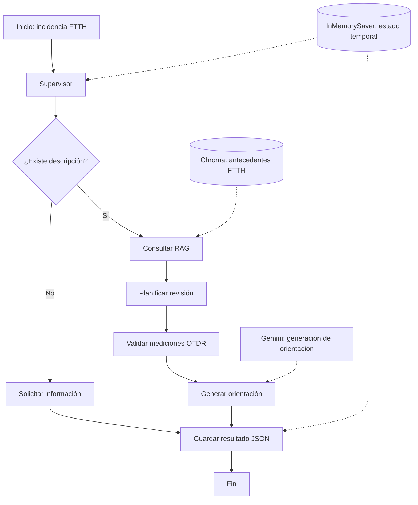

# Arquitectura y orquestación del Agente Inteligente FTTH

## 1. Descripción general

El Agente Inteligente FTTH fue desarrollado utilizando Python y LangGraph como parte de la Evaluación Parcial 2 de Ingeniería de Soluciones con Inteligencia Artificial.

Su objetivo es apoyar el análisis inicial de incidencias en redes FTTH mediante la recuperación de antecedentes, la planificación de verificaciones técnicas y la generación de orientación asistida por Gemini.

El prototipo incorpora un flujo con siete nodos y dos rutas condicionales, según la información recibida.

## 2. Diagrama de orquestación

Las conexiones continuas representan el flujo de ejecución. Las conexiones discontinuas muestran componentes de apoyo utilizados durante el procesamiento.

## 3. Componentes del agente

| Componente | Función |
|---|---|
| Supervisor | Comprueba si la incidencia contiene una descripción. |
| Solicitar información | Detiene el diagnóstico y solicita los antecedentes faltantes. |
| Consultar RAG | Recupera antecedentes relacionados mediante Chroma en modo real. |
| Planificar revisión | Organiza verificaciones técnicas según los datos disponibles. |
| Validar OTDR | Identifica condiciones relevantes del historial de mediciones. |
| Generar orientación | Utiliza Gemini en modo real para generar una respuesta contextualizada. |
| Guardar resultado | Registra información de la ejecución en formato JSON. |

## 4. Recuperación de información y memoria

En modo real, la recuperación semántica utiliza Chroma y embeddings de Gemini. Durante las pruebas se indexaron 80 antecedentes de una base FTTH anonimizada.

El agente utiliza `InMemorySaver` para conservar el estado de ejecución dentro de la sesión de LangGraph.

También registra archivos JSON de resultados. En modo real, estos archivos contienen un resumen limitado de la ejecución y no representan un respaldo completo de todos los checkpoints.

## 5. Planificación y decisiones condicionales

El supervisor utiliza reglas programadas para seleccionar la ruta correspondiente.

Cuando la incidencia no contiene descripción, se solicita información y no
